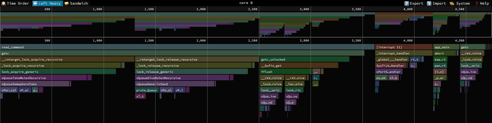

# esp-riscv-trace

Decoder for RISC-V hardware instruction trace captured on Espressif chips.

It reads OpenOCD `.esptrace` captures and `esp-coredump` core ELFs with a trace note. It reconstructs the executed
program flow, resolves each PC to a function and source line through the app ELF, and writes a text dump, a hot-spot
table, the call history that led to a crash, or call stacks for a flame graph. Lost instruction continuity is reported
as a gap.

It is a command-line tool. Other tools, such as `esp-coredump`, read captures through the
[Python API](#python-api). The other modules are internal and have no stable API.

## Supported chips

| Chip | Packet format |
| --- | --- |
| ESP32-C5 | Efficient Trace 2.0 |
| ESP32-C6 | Processor Trace 1.0 |
| ESP32-C61 | Efficient Trace 2.0 |
| ESP32-H2 | Processor Trace 1.0 |
| ESP32-H21 | Processor Trace 1.0 |
| ESP32-H4 | Efficient Trace 2.0 |
| ESP32-P4 | Efficient Trace 2.0 |
| ESP32-S31 | Efficient Trace 2.0 |

## Installation

Requires Python 3.11 or newer.

```bash
pip install esp-riscv-trace
```

Development install:

```bash
pip install -e '.[dev,test]'
pre-commit install -t pre-commit -t commit-msg
```

## Capturing a trace

Enable `CONFIG_ESP_RISCV_TRACE_ENABLE` in the ESP-IDF application. The decoder reads loop-mode captures.

From OpenOCD (needs `CONFIG_ESP_RISCV_TRACE_OPENOCD`), in the telnet or GDB console:

```text
esp riscv_trace start loop trace.esptrace        # start tracing every traced core
esp riscv_trace stop                             # stop and write trace.esptrace
esp riscv_trace start loop trace.esptrace 500    # stop by itself after 500 ms
```

After a panic, the firmware stops the trace before the debugger halts, and `esp riscv_trace stop` writes it.
`esp riscv_trace dump <file>` writes buffers that are already stopped.

One capture holds only the last few milliseconds before it stopped. For a profile of a running application, take
many captures and sum them with `stats`. Save this OpenOCD procedure as `sample.tcl`. It waits a random 0.5 to 1.5
times `interval_ms` between captures, so periodic work does not line up with them:

```tcl
proc riscv_trace_sample {prefix count {interval_ms 100}} {
    for {set i 0} {$i < $count} {incr i} {
        esp riscv_trace start loop [format "%s_%04d.esptrace" $prefix $i]
        sleep [expr {int($interval_ms * (0.5 + rand()))}]
        esp riscv_trace stop
    }
}
```

The application must not start the trace at boot. Reset the target and let it boot before the first capture:

```bash
openocd -f board/esp32s31-builtin.cfg -f sample.tcl \
    -c "init; reset run; sleep 2000; riscv_trace_sample s 100; shutdown"   # s_0000.esptrace to s_0099.esptrace
esp-riscv-trace stats s_*.esptrace --elf build/app.elf
esp-riscv-trace profile s_*.esptrace --elf build/app.elf --format speedscope --out app.speedscope.json
```

The counts are retired instructions, not time. The trace has no timestamps, so cache misses, wait states and idle
time do not show.

From a core dump: with core dump enabled, the trace starts at boot by default and the core dump stores the buffers.
Pass the core dump ELF (for example from `esp-coredump info_corefile -s coredump.elf ...`) to this tool.

## Quick start

```bash
esp-riscv-trace decode trace.esptrace --elf build/app.elf             # text dump of the executed instructions
esp-riscv-trace decode coredump.elf --elf build/app.elf --core 1      # trace from a core dump, one core
esp-riscv-trace stats trace.esptrace --elf build/app.elf --top 20     # hottest source lines
esp-riscv-trace stats trace.esptrace --elf build/app.elf --merge-cores --per-block
esp-riscv-trace history coredump.elf --elf build/app.elf              # calls and returns that led to the crash
esp-riscv-trace decode coredump.elf --elf build/app.elf --last 50     # last 50 instructions before the crash
esp-riscv-trace profile trace.esptrace --elf build/app.elf > app.folded  # call stacks for a flame graph
```

Without `--elf`, `decode` still runs but prints functions as `?()`. ROM addresses resolve through `--rom-elf` or the
ESP-IDF environment.

## Command reference

```
esp-riscv-trace decode  <capture> [options]
esp-riscv-trace stats   <capture>... --elf PATH [options]
esp-riscv-trace history <capture> --elf PATH [options]
esp-riscv-trace profile <capture>... --elf PATH [options]
```

`-h` or `--help` after a command lists its options. The command output goes to stdout or `--out`. Warnings, errors
and the summary line go to stderr.

Options for every command:

| Option | Meaning |
| --- | --- |
| `--elf PATH` | Application ELF for function names and source lines. Required by `stats`, `history` and `profile` |
| `--rom-elf PATH` | ROM ELF for ROM addresses (requires `--elf`). Without it, the ESP-IDF environment is searched |
| `--core N` | Process only this core |
| `--chip NAME` | Override the chip recorded in the capture. One of the [supported chips](#supported-chips), written like `esp32c5` |
| `--out PATH` | Write the output to a file instead of stdout |
| `--quiet` | Do not print the summary line on stderr |

`decode` adds:

| Option | Meaning |
| --- | --- |
| `--last N` | Write only the last N instructions up to the first fault and the fault itself, or the last N of the trace when there is none |
| `--debug` | Hex-dump each core's raw encoder buffer after its header, and prefix each event line with its packet payload |

A fault is an exception other than `ecall`. With `--last`, the summary still covers the whole trace.

`stats` adds:

| Option | Meaning |
| --- | --- |
| `--top N` | Number of rows in the table (default 20) |
| `--per-block` | Add per-function block entry tables |
| `--merge-cores` | Combine all cores into one table |
| `--debug` | Hex-dump each core's raw encoder buffer after its header. Takes one capture |

`stats` takes several captures of the same app build. It then writes one header with a summary line for every capture
and core, and one table per core with the counts of every capture summed.

`history` adds:

| Option | Meaning |
| --- | --- |
| `--last N` | Number of newest outline items (default 40). `0` shows every item |
| `--json` | Write JSON instead of text |

`profile` adds:

| Option | Meaning |
| --- | --- |
| `--format folded` | One `core 0;caller;function count` line per call stack, for FlameGraph or speedscope (default) |
| `--format speedscope` | A [speedscope](https://www.speedscope.app) file with one profile per core |
| `--merge-cores` | Combine all cores into one profile |

`profile` counts every instruction under the call stack it ran in, outermost function first. A trap adds a frame
such as `[interrupt 21]` or `[illegal instruction]` above the interrupted function. The trace starts inside running
code, so a stack holds only the calls the trace shows, and a gap starts over with no frames. Counts are retired
instructions. The speedscope samples are in trace order, so its time order view follows the trace.

### Exit codes

| Code | Meaning |
| --- | --- |
| `0` | Success |
| `1` | Usage error (invalid arguments or missing required files) |
| `2` | The ELF SHA-256 differs from the one recorded in the capture |
| `3` | Specified `--core N` not found in capture |
| `4` | Decode failure (corrupt container, unsupported hardware, or bad ELF) |

## Output format

`decode` prints a `#` header per core, then the events, then a summary. Shortened output of
`esp-riscv-trace decode tests/esp32c5/stop.esptrace --elf tests/built_apps/esp32c5.elf`:

```text
# chip              esp32c5  target_id=0x0017  revision=0x0065
# core              0  owner=fw
# packet_format     efficient_trace_2_0  address_mode=delta
# app_elf_sha256    match  sha=e09eeed40648e3d7  path=tests/built_apps/esp32c5.elf
...
--- sync pc=0x408023a6 priv=1 [frame seg=0 off=1051 idx=22461] ---
0x408023a6  branchy_work()                    /IDF_PROJECT/main/test_app_main.c:35  [frame seg=0 off=1051 idx=22461]
0x408023b8  branchy_work()                    /IDF_PROJECT/main/test_app_main.c:31  [frame seg=0 off=1059 idx=22462]  # branch=not_taken
...
--- boundary wrap "circular trace memory wraps here" [frame seg=1 off=3264] ---
...
# summary           instructions=48431  syncs=3  traps=0  gaps=21
#                   top_gap_reasons=walker_not_anchored=19, alignment_lost=1, partial_frame=1
```

Event lines are instructions, `sync` (the decoder locks on a known PC), `trap`, `gap` (instruction continuity lost, for
example FIFO overflow or a broken frame), `boundary` (the circular buffer wraps) and `warning`. Only gaps count as
lost instructions.

The encoder does not trace ROM code. A call into ROM shows as the jump with `next=untraced`, then a gap `untraced`,
then a `sync` where the core comes back into traced code:

```text
0x4200a842  _read_r_console()                 /IDF/components/esp_stdio/stdio_syscalls_simple.c:45  [frame seg=0 off=1724 idx=2043]  # uninferable next=untraced
--- gap untraced "the jump at 0x4200a842 leaves the traced range (qual_status=1)" [frame seg=0 off=1724 idx=2043] ---
--- sync pc=0x4200a846 priv=1 [frame seg=0 off=1729 idx=2044] ---
```

`history` prints the calls, returns, interrupts and context switches per core up to the first fault. Each row shows
the PC whose source line it names, the instructions retired until the next row, and the outline. A call that returns
before anything else happens is one row, `<untraced>` is code the encoder did not trace, and repeated passes of the
same rows show once as `loop xN`. The end of `esp-riscv-trace history tests/esp32c5/coredump.elf --elf
tests/built_apps/esp32c5.elf`:

```text
# history           core=0  items=40  omitted=496  instructions=4617
# fault             illegal instruction in panic_abort  epc=0x40806e94  tval=0x00000000
#         pc    insns  outline                                                                   source
...
0x42009bec       17    } getc                                                                  /IDF_PROJECT/main/test_app_main.c:60
0x42009cec        5  } read_command                                                            /IDF_PROJECT/main/test_app_main.c:101
0x42009cfa       23  strcmp()                                                                  /IDF_PROJECT/main/test_app_main.c:101
0x42009cba       14  abort() {                                                                 /IDF_PROJECT/main/test_app_main.c:102
0x40805ae2        0    <untraced>()                                                            /IDF/components/esp_libc/src/abort.c:25
0x40805af4        0    <untraced>()                                                            /IDF/components/esp_libc/src/abort.c:27
0x40805b04        0    <untraced>()                                                            /IDF/components/esp_libc/src/abort.c:28
                 39    loop x4 {
0x40805b3e        0      <untraced>()                                                          /IDF/components/esp_libc/src/abort.c:35
                       }
0x40805b2a        3    esp_system_abort() {                                                    /IDF/components/esp_libc/src/abort.c:38
0x40806e50        5      panic_abort() {                                                       /IDF/components/esp_system/port/esp_system_chip.c:88
0x40806e94        0        !! illegal instruction in panic_abort  epc=0x40806e94  tval=0x00000000  /IDF/components/esp_system/panic.c:508
```

Other rows are `~> f` (a jump into another function), `interrupt N in f {` and `ecall in f {` with the `} mret` that
returns from them, `<~ switch to f` (a trap return into other code than the interrupted one, usually another task),
and `-- gap reason`. A return that does not match its call is marked `!!`. Depths compare only between a gap or
context switch and the next one.

`stats` prints the same `#` header, then one table per core. The table of
`esp-riscv-trace stats tests/esp32c5/stop.esptrace --elf tests/built_apps/esp32c5.elf --top 3`:

```text
# stats             core=0  instructions=48431  denominator=48431  top=3
#    pct  count  function                          file:line
   49.98  24206  branchy_work()                    /IDF_PROJECT/main/test_app_main.c:31
   24.97  12092  branchy_work()                    /IDF_PROJECT/main/test_app_main.c:32
   18.73   9069  branchy_work()                    /IDF_PROJECT/main/test_app_main.c:35
```

`profile` writes one line per call stack with the instructions retired in it. Some lines of
`esp-riscv-trace profile tests/esp32c5/coredump.elf --elf tests/built_apps/esp32c5.elf`:

```text
core 0;[interrupt 21];_interrupt_handler;rtos_int_exit;vTaskSwitchContext 75
core 0;app_main;abort 83
core 0;app_main;abort;esp_system_abort;panic_abort 5
core 0;app_main;abort;esp_system_abort;panic_abort;[illegal instruction];_panic_handler 53
core 0;app_main;strcmp 23
```

The same capture with `--format speedscope`, in the Left Heavy view of [speedscope](https://www.speedscope.app):



## Python API

```python
from esp_riscv_trace import open_capture

with open_capture("coredump.elf", elf="build/app.elf") as capture:
    for core in capture.cores:
        history = core.history(last=20)  # the same outline as the history command
        if history.fault is not None:
            where = capture.resolve(history.fault.pc)
            print(core.core_id, where.function, where.file, where.line)
        for event in core.events():  # decoded events, oldest first
            ...
```

`open_capture` does not stop on an ELF that differs from the capture. `core.note.elf_sha_status` tells the caller.
Problems that do not stop decoding, such as a missing ROM ELF, are collected in `capture.warnings` instead of being
printed. `capture.image` reads code bytes and names functions.

## Contributing

This project uses [pre-commit](https://pre-commit.com/) to enforce code formatting and commit style. Set up the
hooks with the development install above.

Run the tests from the repository root with `pytest`. [`tests/README.md`](./tests/README.md) explains the test
captures and how to regenerate them.

## License

Apache 2.0. See [`LICENSE`](./LICENSE).
